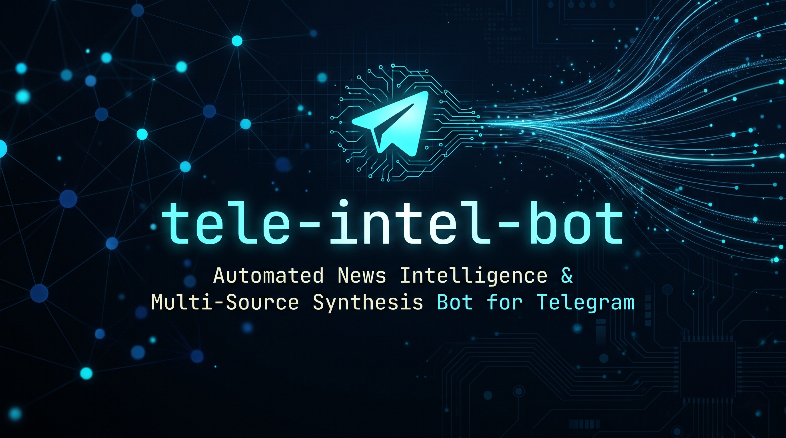
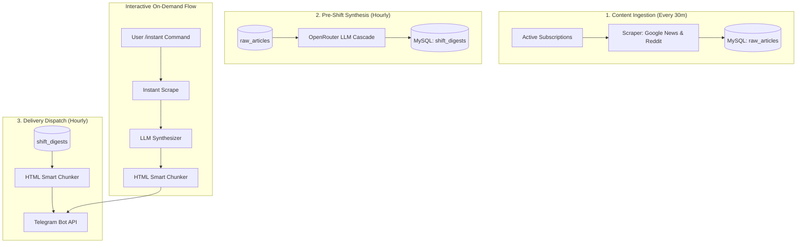

# tele-intel-bot

Automated news intelligence and multi-source synthesis bot for Telegram.




## Table of Contents

- [About](#about)
- [Key Features](#key-features)
- [Architecture Overview](#architecture-overview)
- [Tech Stack](#tech-stack)
- [Getting Started](#getting-started)
  - [Prerequisites](#prerequisites)
  - [Installation](#installation)
  - [Configuration](#configuration)
  - [Running the Application](#running-the-application)
  - [Verification](#verification)
- [Usage](#usage)
- [Project Structure](#project-structure)
- [Deployment](#deployment)
- [Data Model](#data-model)
- [Roadmap](#roadmap)
- [Contributing](#contributing)
- [License](#license)
- [Acknowledgements](#acknowledgements)

---

## About

Information overload makes tracking multiple news topics noisy, fragmented, and time-consuming. Raw RSS feeds and social media posts contain duplicate headlines, promotional press releases, and unverified rumors across languages.

`tele-intel-bot` runs as a continuous background daemon that aggregates feeds, extracts article content, and synthesizes structured, executive-grade intelligence briefs using large language models. The bot delivers sanitized HTML digests directly to an authenticated Telegram admin account on demand or on schedule.

---

## Key Features

- **Zero-Trust Access Control**: Enforces strict Telegram user ID validation on every incoming update, blocking unauthorized users.
- **Universal Multi-Topic Research**: Synthesizes structured updates on any topic (technology, sports, business, geopolitics) on demand via `/instant`.
- **Scheduled Digest Delivery**: Automatically ingests feeds every 30 minutes and dispatches pre-shift summaries at configured hours.
- **Strict Evidence Grounding**: Eliminates hallucinated URLs by having the AI output input article indices; the application maps them directly to verified source links.
- **Deterministic Multi-Source Verification**: Tags events as multi-source or single-source based on actual cited articles rather than model speculation.
- **Global Localization (i18n)**: Supports 9 languages (`en`, `vi`, `zh`, `ja`, `ko`, `de`, `fr`, `ru`, `es`) for both UI menus and AI-generated text, stored persistently per user.
- **High-Availability AI Cascade**: Routes synthesis requests through OpenRouter with automatic model fallback (`deepseek/deepseek-chat`, Nemotron, Gemma) and emergency raw digest fallback.
- **Automated Data Retention**: Purges raw ingested articles older than 3 days daily at 03:00 AM VN time (`UTC+7`) to prevent database bloat.

---

## Architecture Overview

The system operates across three scheduled background loops and an interactive event loop:



See [docs/ARCHITECTURE.md](docs/ARCHITECTURE.md) for full pipeline and timing specifications.

---

## Tech Stack

| Component | Technology | Role |
| :--- | :--- | :--- |
| Runtime | Node.js (v20+ LTS) | Asynchronous runtime for bot logic and scheduled tasks |
| Bot Framework | `grammy` | Telegram Bot API client with conversation plugin |
| Database | MySQL 8.0 (`mysql2`) | Relational persistence for subscriptions, articles, and settings |
| Parsing | `cheerio` | Scraping and full-text extraction from news feeds and HTML |
| AI Synthesis | OpenRouter (`openai` SDK) | LLM inference with model cascading (DeepSeek V3, Nemotron, Gemma) |
| Scheduler | `node-cron` | In-process cron runner for background pipelines |
| Containerization | Docker & Docker Compose | Containerized application and database deployment |

---

## Getting Started

### Prerequisites

- Node.js 20.0.0 or higher (if running natively)
- Docker and Docker Compose (recommended)
- A Telegram Bot Token from [@BotFather](https://t.me/BotFather)
- An OpenRouter API Key

### Installation

Clone the repository and enter the project folder:

```bash
git clone https://github.com/your-username/tele-intel-bot.git
cd tele-intel-bot
```

### Configuration

Copy the example environment file and fill in your credentials:

```bash
cp .env.example .env
```

Environment variables:

| Variable | Required | Description | Example |
| :--- | :--- | :--- | :--- |
| `BOT_TOKEN` | Yes | Telegram Bot token from BotFather | `123456789:ABCdefGhIJKlmNoPQRsTUVwxyZ` |
| `ADMIN_CHAT_ID` | Yes | Telegram user ID authorized to use the bot | `6211306846` |
| `OPENROUTER_API_KEY` | Yes | API key for OpenRouter models | `sk-or-v1-abcdef123456...` |
| `LLM_MODEL` | Yes | Primary OpenRouter free model ID (must end with `:free`) | `nvidia/nemotron-3-ultra-550b-a55b:free` |
| `LLM_FALLBACK_MODEL` | Yes | Fallback OpenRouter free model ID (must end with `:free`) | `nvidia/nemotron-3.5-lightning:free` |
| `LLM_DAILY_LIMIT` | No | Maximum daily LLM requests before pausing non-essential calls (default: `40`) | `40` |
| `MYSQL_HOST` | Yes | Database host (`mysql` in Docker, `127.0.0.1` locally) | `127.0.0.1` |
| `MYSQL_PORT` | Yes | Database port | `3307` |
| `MYSQL_USER` | Yes | MySQL database user | `bot_user` |
| `MYSQL_PASSWORD` | Yes | MySQL application user password (alphanumeric only) | `bot_password_example` |
| `MYSQL_ROOT_PASSWORD` | Yes | MySQL root password (alphanumeric only, must differ from MYSQL_PASSWORD) | `root_password_example` |
| `MYSQL_DATABASE` | Yes | MySQL database name | `tele_intel_bot` |

> [!IMPORTANT]
> **Zero-Cost Operation & Free Tier Limits**:
> - **Free Tier Models Only**: The bot enforces a code-level guard requiring model IDs to end with `:free`. Any request referencing a non-free model ID is rejected before transmission.
> - **OpenRouter Free Tier Constraints**: Free models operate under rate limits of **20 requests per minute (RPM)** and **50 requests per day (RPD)**. The credit limit applies only to paid usage; this bot additionally enforces free models in code, so paid usage cannot occur.
> - **Development & Test Consumption**: Running manual test scripts (such as `test_manual_anti_repetition.js` or `test_vietnamese_anti_repetition.js`) makes real calls to OpenRouter and increments the daily counter in `llm_daily_usage`.
> - **Model Availability**: Free community models on OpenRouter may be deprecated or rotated by providers; the system automatically falls back to `LLM_FALLBACK_MODEL` and sends an alert.
> - **Verification & Credit Limit**:
>   - **Activity Page**: [https://openrouter.ai/activity](https://openrouter.ai/activity) — lists every request with model ID, token count, and cost.
>   - **API Keys**: "API Keys" is a separate item in the left sidebar of the OpenRouter dashboard, next to Activity and Logs. Direct link: [https://openrouter.ai/settings/keys](https://openrouter.ai/settings/keys). Set a hard credit limit of **0.01 USD** (not 0.00 — a minimal safety net that is effectively free while still providing a hard ceiling for paid usage).

### Daily Request Budget & Schedule Capacity

Each digest synthesis is capped at **at most 2 requests in total** (1 initial request + at most 1 fallback or JSON correction retry):

| Active Topics ($N$) | Scheduled Shifts ($S$) | Nominal Requests / Day | Worst-Case Max (with Retries) | Daily Limit Margin (`LLM_DAILY_LIMIT=40`) |
| :--- | :--- | :--- | :--- | :--- |
| 2 topics | 3 shifts (07:00, 12:00, 19:00) | **6 calls** | 12 calls | 28 calls remaining for `/instant` |
| 3 topics | 3 shifts (07:00, 12:00, 19:00) | **9 calls** | 18 calls | 22 calls remaining for `/instant` |
| 5 topics | 3 shifts (07:00, 12:00, 19:00) | **15 calls** | 30 calls | 10 calls remaining for `/instant` |
| 5 topics | 4 shifts (07:00, 12:00, 17:00, 21:00) | **20 calls** | 40 calls | Reaches daily cap in worst-case |

### Database Administration & Verification (Safe Password Practices)

To inspect database records without exposing credentials in command-line arguments or shell history:

```bash
# Option 1: Safe env-var method (no password on command line or in shell history)
docker exec tele_intel_mysql sh -c 'MYSQL_PWD="$MYSQL_PASSWORD" mysql -u "$MYSQL_USER" "$MYSQL_DATABASE" -e "SELECT * FROM llm_daily_usage;"'

# Option 2: Interactive prompt (safely prompts for password)
docker exec -it tele_intel_mysql mysql -u bot_user -p tele_intel_bot

# Option 3: Using the container's internal environment variable
docker exec tele_intel_mysql sh -c 'mysql -u "$MYSQL_USER" -p"$MYSQL_PASSWORD" "$MYSQL_DATABASE" -e "SELECT * FROM llm_daily_usage;"'
```

### Running the Application

#### Option A: Docker Compose (Recommended)

Start the MySQL container and bot daemon:

```bash
docker-compose up -d --build
```

View running logs:

```bash
docker-compose logs -f bot
```

#### Option B: Native Node.js

Install dependencies:

```bash
npm install
```

Initialize your MySQL database using `init.sql`, then start the daemon:

```bash
node index.js
```

### Verification

Check the container logs or terminal output. You should see:

```text
Database schema initialized and verified.
Background cron jobs scheduled successfully.
Telegram Bot @yourbot is ONLINE and listening.
```

Open Telegram, start a chat with your bot, and send `/start`.

---

## Usage

All bot interactions occur through Telegram commands and interactive keyboards.

| Command | Description |
| :--- | :--- |
| `/start` | Opens the language picker (first time) or displays the localized main menu |
| `/instant` | Prompts for any keyword, entity, or topic for immediate intelligence research |
| `/add` | Launches interactive conversation to create a scheduled digest |
| `/list` | Displays active subscriptions with toggles and delete controls |
| `/addfeed` | Adds a custom RSS feed URL: `/addfeed <url> [topic] [name]` |
| `/listfeeds` | Lists and manages active custom RSS feeds with one-click deletion |
| `/lang` | Opens the language switcher keyboard |
| `/help` | Displays system help and guidance |

---

## Project Structure

```text
tele-intel-bot/
├── docs/                     # Architectural, database, and prompt documentation
│   ├── ARCHITECTURE.md
│   ├── DATABASE.md
│   ├── IMAGE_PROMPTS.md
│   ├── PROMPTS_AND_SYNTHESIS.md
│   └── coding_standards_clean_code_security_guidelines.md
├── lib/                      # Core application modules
│   ├── chunker.js            # HTML formatting and message boundary chunking
│   ├── db.js                 # MySQL pool initialization
│   ├── db_operations.js      # Relational database queries
│   ├── fulltext_extractor.js # Article body extraction
│   ├── i18n.js               # Multi-language dictionary and helpers
│   ├── intent_analyzer.js    # Topic and domain classification
│   ├── scraper.js            # RSS and Reddit feed ingestion
│   ├── sources_config.js     # Media source reputation lists
│   └── synthesizer.js        # AI synthesis and OpenRouter cascade
├── test/                     # Automated test suite
│   ├── chunker.test.js
│   ├── i18n.test.js
│   └── synthesizer.test.js
├── bot.js                    # Telegram bot handlers and UI workflows
├── index.js                  # Process entry point and background cron pipelines
├── init.sql                  # Database schema initialization script
├── docker-compose.yml        # Docker service configuration
├── Dockerfile                # Node.js Alpine container definition
└── package.json              # Project dependencies and metadata
```

See [docs/coding_standards_clean_code_security_guidelines.md](docs/coding_standards_clean_code_security_guidelines.md) for coding conventions.

---

## Deployment

The system is configured to run as a 24/7 background service in Docker:

- The containers are configured with `restart: unless-stopped`.
- The MySQL container runs health checks before the bot service boots (`condition: service_healthy`).
- Timezone is set to `Asia/Ho_Chi_Minh` (`UTC+7`) across containers to ensure morning and evening shifts trigger at proper local times.

To stop the service:

```bash
docker-compose down
```

To update after pulling new code:

```bash
docker-compose up -d --build bot
```

---

## Database Password Changes

> [!WARNING]
> Changing the database password incorrectly will cause the bot to lose access to the database. Follow the procedure below in the exact order shown.

### Option A: Keep existing data (recommended)

This procedure changes the bot user's password **without touching the database volume**.

1. Connect to the running MySQL container as root (interactive prompt):
   ```bash
   docker exec -it tele_intel_mysql mysql -u root -p
   ```
2. Inside MySQL, run the password change (replace `<newpassword>` with the new alphanumeric password):
   ```sql
   ALTER USER 'bot_user'@'%' IDENTIFIED BY '<newpassword>';
   FLUSH PRIVILEGES;
   EXIT;
   ```
3. Update `MYSQL_PASSWORD` in your `.env` file to `<newpassword>`.
4. Restart only the bot container (not MySQL — the volume is untouched):
   ```bash
   docker-compose up -d bot
   ```

**Order matters:** The database password must be changed before restarting the bot. If you restart the bot first, it will fail to connect.

### Option B: No data to keep — full reset [DESTRUCTIVE]

> [!CAUTION]
> **[DESTRUCTIVE]** The steps below permanently delete all subscriptions, digests, and usage history. Back up first.

1. **[DESTRUCTIVE]** Back up the existing database:
   ```bash
   docker exec tele_intel_mysql sh -c 'MYSQL_PWD="$MYSQL_PASSWORD" mysqldump -u "$MYSQL_USER" "$MYSQL_DATABASE"' > backup_$(date +%Y%m%d).sql
   ```
2. Stop all containers:
   ```bash
   docker-compose down
   ```
3. **[DESTRUCTIVE]** Remove the MySQL data volume (this deletes ALL database data):
   ```bash
   docker volume rm tele-intel-bot_mysql_data
   ```
4. Update both `MYSQL_PASSWORD` and `MYSQL_ROOT_PASSWORD` in `.env` to new alphanumeric values.
5. Restart everything (MySQL will re-initialize from `init.sql`):
   ```bash
   docker-compose up -d
   ```

---

## Data Model

The database (`tele_intel_bot`) consists of 7 primary tables:

- **`subscriptions`**: User scheduled topics, delivery hour, frequency, and active status.
- **`custom_feeds`**: User-configured custom RSS feeds (`feed_url`, `feed_name`, `topic`).
- **`raw_articles`**: Ingested articles with composite uniqueness on `(topic, link)`.
- **`shift_digests`**: Staged JSON payloads for scheduled hourly delivery.
- **`user_settings`**: Per-user preferences (e.g., chosen UI and synthesis language).
- **`source_reputation`**: Domain credibility scores and feedback statistics.
- **`feedback_logs`**: User confirmations or disputes on delivered reports.

See [docs/DATABASE.md](docs/DATABASE.md) for the complete schema and indexing strategy.

---

## Roadmap

- [x] Multi-source news feed ingestion (Google News RSS and Reddit)
- [x] LLM synthesis pipeline with OpenRouter cascade
- [x] Inverted pyramid formatting with bold highlights and core verdict
- [x] Real-source link attribution via index mapping (zero URL hallucination)
- [x] Persistent multi-language interface and report generation (9 languages)
- [x] Zero-trust admin authorization lock
- [x] Automated 3-day data retention cleanup
- [x] Custom RSS feed manager (`/addfeed`, `/listfeeds`)
- [x] Automated unit test suite via `node:test` (`npm test`)

---

## Contributing

1. Check existing issues or open a new issue describing the bug or feature.
2. Fork the repository and create a feature branch (`git checkout -b feature/your-feature`).
3. Ensure all code follows the Single Responsibility Principle and parameterized query rules in [docs/coding_standards_clean_code_security_guidelines.md](docs/coding_standards_clean_code_security_guidelines.md).
4. Commit your changes with clear messages (`git commit -m "Add feature description"`).
5. Open a Pull Request against the main branch.

---

## License

This project is licensed under the MIT License - see the [LICENSE](LICENSE) file for details.

---

## Acknowledgements

- [grammY](https://grammy.dev/) - Modern Telegram Bot framework for Node.js
- [OpenRouter](https://openrouter.ai/) - Unified LLM routing and API gateway
- [cheerio](https://cheerio.js.org/) - Fast, flexible HTML and XML parsing for Node.js
- [mysql2](https://github.com/sidorares/node-mysql2) - MySQL client for Node.js
